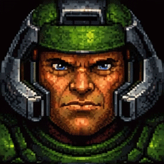
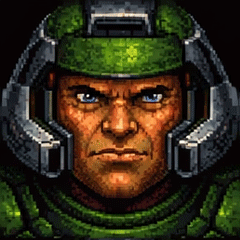
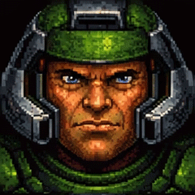

# Doomguy Theme

A Doomguy-inspired **assets-only theme** for compatible Xiaozhi ESP32-S3 firmware and 240×240 displays.

  

## Download

Download [assets-doomguy-240.bin](dist/assets-doomguy-240.bin) using GitHub's **Download raw file** button. This is an assets partition image, not a complete firmware image.

| Setting | Value |
|---|---|
| Display | 240×240, RGB565, color |
| Animations | 21 emotion mappings, 441 frames in total |
| Font | Original `font_custom_14_4.bin` |
| Text color | `#ffffff` |
| Background | `#121212` in light and dark modes |
| Package size | 4,412,389 bytes |

SHA256:

```text
38aa3ca494f2872cefdbe99083bf4a245297cad1b6c048c495452cf98c857c61
```

The package preserves the original 240×240 GIF files, frame timing, font, and colors. It does not require a firmware source-code patch when used with firmware that already supports this external asset format. Text layout and layering remain controlled by the installed firmware.

## Installation

The target used to prepare this package was **Spotpear ESP32-S3 1.28 BOX**, with 16 MiB flash and a 240×240 display. Its assets partition starts at **0x800000** and has a capacity of **0x800000** (8 MiB).

1. Confirm that your installed firmware supports this Xiaozhi mmap asset format and check its partition table. Do not assume that other boards use the same address.
2. Back up your existing assets.
3. For the exact partition layout above, select `assets-doomguy-240.bin` in Flash Download Tool and set its address to **0x800000**. Select only that row and preserve the existing device flash settings.
4. Write the assets and restart the device. Do not erase the entire flash or write this assets-only image at `0x0`.

This repository supplies no firmware binary or firmware modifications. Compatibility with other builds must be checked before writing the partition.

## Included files

- `assets/`: 21 GIFs, original binary font, theme index, and file manifest.
- `dist/`: ready-to-use assets image and SHA256 checksum.
- `validation/`: per-animation frame counts, timing, and hashes.

All GIFs were decoded during packaging: 240×240, 441 total frames, preserved timing. The asset package was unpacked, checked for references, bounds and checksum, and rebuilt byte-for-byte from the included files. Physical display and long-running playback testing remain pending.

## Attribution

This is an unofficial fan theme, with no affiliation or endorsement by the owners of DOOM, Doomguy, Xiaozhi, or their trademarks. The artwork and font were supplied with an existing theme; their original authorship and redistribution terms have not been independently established. No ownership or additional license to those assets is claimed. See [NOTICE.md](NOTICE.md).
